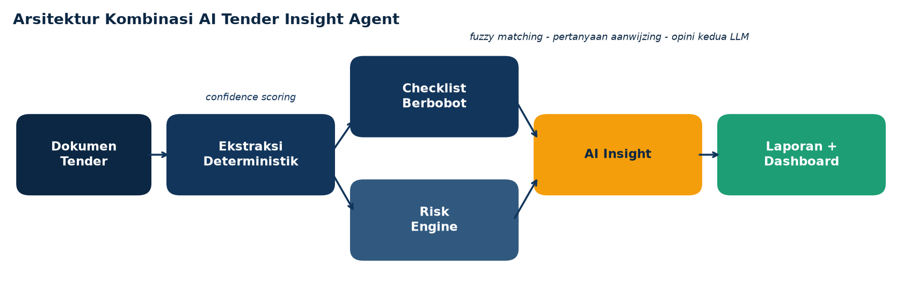
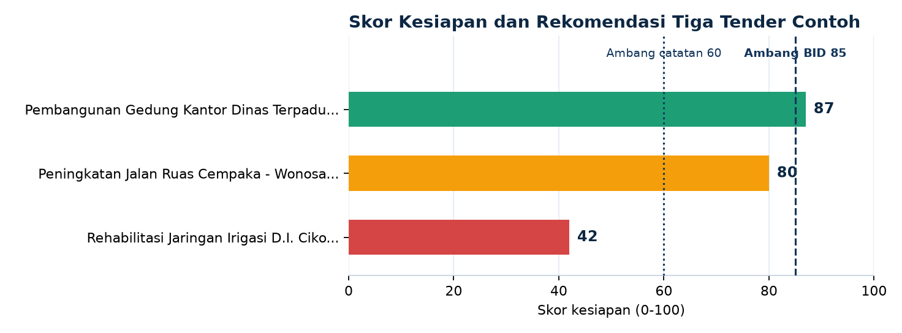
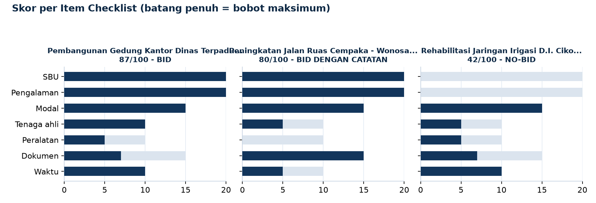
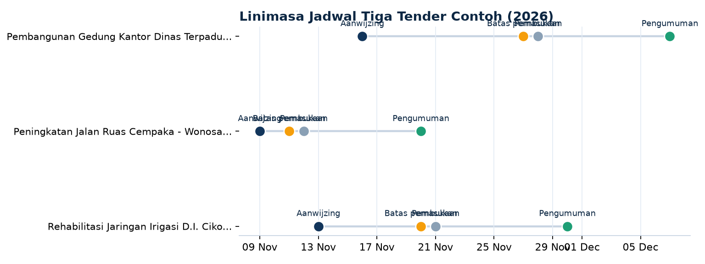

# Tender Insight Agent

**Agent analisis bid/no-bid untuk tender konstruksi Indonesia dengan kombinasi AI berlapis.** Membaca teks pengumuman pascakualifikasi (format LPSE/SPSE), mengekstrak syarat kualifikasi dan jadwal kritis, mencocokkannya dengan profil perusahaan memakai pencocokan semantik, menilai risiko, lalu mengeluarkan skor kesiapan, rekomendasi **BID**, **BID DENGAN CATATAN**, atau **NO-BID**, draf pertanyaan aanwijzing, dan opini kedua terstruktur.

*English summary: A bid/no-bid analysis agent for Indonesian construction tenders. A deterministic NLP core extracts requirements and dates with confidence scores; fuzzy semantic matching checks them against a company profile; a weighted checklist issues an auditable BID / BID WITH NOTES / NO-BID verdict; a risk engine scores schedule, workload intensity, qualification gaps and funding source; an optional LLM layer writes the executive narrative and a structured second opinion. Ships with an HTML dashboard, an evaluation notebook, SQLite history storage, and a one-command demo.*



## Kombinasi AI di dalamnya

Agent ini sengaja **bukan** satu model yang menebak semuanya. Lima lapisan bekerja berurutan, masing-masing dengan tugas yang dapat diaudit:

1. **Ekstraksi deterministik (NLP berbasis aturan)** — `extractor.py`, `patterns.py`. Parser uang (`Rp 12.450.000.000,00`, `Rp 2,5 miliar`) dan tanggal Bahasa Indonesia, regex berlabel LPSE untuk nama paket, instansi, HPS, jangka waktu pelaksanaan, metode evaluasi, jenis kontrak, lima tanggal jadwal, kode SBU, syarat pengalaman dan modal, tenaga ahli, peralatan, dan dokumen wajib.
2. **Confidence scoring** — setiap kelompok field (identitas, jadwal, kualifikasi, dokumen, pelaksanaan) diberi label keyakinan tinggi, sedang, atau rendah. Hasil bacaan yang meragukan tidak disembunyikan: ia menjadi bahan pertanyaan klarifikasi.
3. **Fuzzy semantic matching** — `checklist.py`. Syarat dicocokkan ke profil perusahaan dengan normalisasi teks, penghapusan keterangan kurung, dan kemiripan himpunan kata (ambang Jaccard 0,85). Cukup cerdas untuk mengenali variasi tulisan, cukup ketat untuk tetap membedakan kata penentu seperti "teraudit" (kemiripan 0,80, di bawah ambang).
4. **Checklist berbobot + Risk Engine** — `checklist.py`, `risk.py`. Tujuh item checklist (SBU 20, pengalaman 20, modal 15, dokumen 15, tenaga ahli 10, peralatan 10, waktu 10) menghasilkan skor kesiapan dan rekomendasi dengan aturan gugur keras. Risk Engine menilai lima faktor terpisah (jadwal pemasukan, jendela persiapan, intensitas nilai pekerjaan per hari, kesiapan kualifikasi, sumber dana) menjadi skor risiko 0 sampai 100.
5. **AI Insight (LLM opsional)** — `ai_insight.py`, `llm_summary.py`. Menyusun draf pertanyaan aanwijzing dari celah checklist dan field berkeyakinan rendah, menulis narasi eksekutif, dan memberi opini kedua dalam JSON terstruktur (risiko utama, peluang, strategi). Bila `TENDER_INSIGHT_LLM_API_KEY` terisi, tugas bahasa dikerjakan LLM lewat endpoint kompatibel OpenAI; tanpa kunci, templat aturan mengambil alih. Angka tidak pernah dibuat oleh lapisan bahasa.

## Hasil pada data contoh

Tiga dokumen pengumuman fiktif dianalisis terhadap satu profil perusahaan contoh, tanggal analisis dikunci 7 November 2026:

| Dokumen | HPS | Skor | Rekomendasi | Risiko | Pertanyaan aanwijzing |
|---|---|---|---|---|---|
| Pembangunan Gedung Kantor Dinas Terpadu Tahap II | Rp 12.450.000.000 | 87/100 | BID | Sedang (39) | 4 |
| Peningkatan Jalan Ruas Cempaka - Wonosari | Rp 6.875.500.000 | 80/100 | BID DENGAN CATATAN | Tinggi (100) | 5 |
| Rehabilitasi Jaringan Irigasi D.I. Cikopo Hulu | Rp 3.275.000.000 | 42/100 | NO-BID | Sedang (40) | 5 |

Perhatikan paket jalan: skor kesiapannya 80, tetapi risikonya **Tinggi** karena jendela dari aanwijzing ke batas pemasukan hanya 2 hari, peralatannya belum ada, dan dananya DAK. Skor dan risiko memang sengaja dipisah.







## Verifikasi

- **62 dari 62 tes lulus** (`pytest`): parser uang dan tanggal, ekstraksi termasuk field baru dan confidence, fuzzy matching termasuk kasus batas "teraudit", checklist dan ambang rekomendasi, Risk Engine per faktor, AI Insight, dan penyimpanan SQLite.
- **Evaluasi ekstraksi 27 dari 27 field benar (100%)** pada set contoh: 9 field per dokumen dibandingkan dengan `samples/expected.json`. Jalankan dengan `python run_eval.py`. Angka ini mengukur set contoh yang disertakan, bukan klaim atas seluruh variasi dokumen LPSE.
- **Notebook evaluasi** di `notebooks/evaluasi.ipynb` menjalankan ulang seluruh pipeline dan menampilkan keluaran nyatanya.

## Cara pakai

```bash
pip install -r requirements.txt

# Demo lengkap satu perintah: evaluasi, tes, laporan, visual, data dashboard
bash scripts/run_demo.sh

# Analisis satu dokumen
python cli.py samples/tender_gedung.txt --profile samples/company_profile.json --date 2026-11-07

# Banyak dokumen, laporan Markdown ke folder, atau keluaran JSON
python cli.py samples/*.txt --profile samples/company_profile.json --date 2026-11-07 --out laporan-contoh/
python cli.py samples/tender_gedung.txt --profile samples/company_profile.json --json

# Dashboard interaktif (HTML/CSS/JavaScript statis, tanpa server)
python build_dashboard_data.py   # segarkan data dari hasil analisis terbaru
# lalu buka dashboard/index.html di browser

# Riwayat analisis tersimpan (SQLite + SQL)
# skema di db/schema.sql, contoh query rekap di db/queries.sql, modul store.py

# Lewat Docker
docker build -t tender-insight-agent .
docker run --rm tender-insight-agent
```

Opsional, aktifkan lapisan LLM:

```bash
export TENDER_INSIGHT_LLM_API_KEY=...
export TENDER_INSIGHT_LLM_MODEL=gpt-4o-mini
export TENDER_INSIGHT_LLM_BASE_URL=https://api.openai.com/v1
```

## Komponen dan bahasa

Repo ini memang multi-bahasa karena setiap komponen punya peran nyata:

| Bahasa | Komponen |
|---|---|
| Python | Inti agent (ekstraksi, checklist, risk engine, AI insight), CLI, evaluasi, tes, pembuat visual dan data dashboard |
| HTML / CSS / JavaScript | Dashboard interaktif di `dashboard/` |
| Jupyter Notebook | `notebooks/evaluasi.ipynb`, evaluasi pipeline dengan keluaran nyata |
| SQL | Skema dan query rekap SQLite di `db/` |
| Shell | `scripts/run_demo.sh` |
| Dockerfile | Resep container di `Dockerfile` |

## Struktur repo

```
cli.py                    Antarmuka baris perintah
extractor.py              Ekstraksi deterministik + confidence scoring
patterns.py               Kamus kata kunci jadwal, daftar, bulan Indonesia
checklist.py              Checklist berbobot, fuzzy matching, rekomendasi
risk.py                   Risk Engine lima faktor
ai_insight.py             Pertanyaan aanwijzing + opini kedua (LLM opsional)
llm_summary.py            Narasi eksekutif (LLM opsional, templat bawaan)
report.py                 Pembuat laporan Markdown
store.py                  Penyimpanan riwayat analisis ke SQLite
run_eval.py               Evaluasi akurasi ekstraksi
make_visuals.py           Pembuat grafik README dari hasil analisis nyata
build_dashboard_data.py   Pembuat data dashboard dari hasil analisis nyata
samples/                  3 pengumuman fiktif, profil perusahaan, expected.json
tests/                    62 tes pytest
dashboard/                Dashboard HTML/CSS/JavaScript + data.js
notebooks/                evaluasi.ipynb
db/                       schema.sql dan queries.sql
scripts/                  run_demo.sh
docs/img/                 Grafik README (skor, checklist, linimasa, arsitektur)
Dockerfile                Resep container
```

## Contoh potongan laporan

```markdown
## Analisis Risiko

**Level risiko: Sedang (skor risiko 39/100)**

| Faktor | Level | Poin | Keterangan |
|---|---|---|---|
| Jadwal pemasukan | Rendah | 0 | Sisa 20 hari menuju batas pemasukan, cukup aman. |
| Jendela persiapan | Sedang | 10 | 11 hari dari aanwijzing ke batas pemasukan. |
| Intensitas pelaksanaan | Sedang | 15 | Nilai pekerjaan Rp 69.166.666/hari selama 180 hari kalender. Cukup padat, perlu mobilisasi cepat. |
| Kesiapan kualifikasi | Sedang | 14 | 0 item gugur dan 2 item kurang dari checklist kesiapan. |
| Sumber dana | Rendah | 0 | Sumber dana APBD Kabupaten Sukamaju adalah pola pendanaan standar. |

## AI Insight

### Draf Pertanyaan Aanwijzing

1. Terkait dokumen Laporan Keuangan Teraudit Tahun Terakhir yang belum kami lengkapi: apakah dokumen tersebut wajib dilampirkan pada tahap penawaran, dan apakah tersedia format atau contoh resmi dari panitia?
2. Apakah peralatan utama yang belum kami miliki dapat dipenuhi melalui sewa atau perjanjian dukungan peralatan, dan apakah bukti kepemilikan atau sewa harus dilampirkan pada dokumen penawaran?
```

## Batasan dan catatan

- Seluruh dokumen dan profil di `samples/` adalah **data fiktif** untuk demonstrasi.
- Ekstraksi dirancang untuk format pengumuman pascakualifikasi yang lazim; format yang sangat berbeda menghasilkan field kosong yang tampil sebagai status KURANG dan pertanyaan klarifikasi, bukan tebakan.
- Rekomendasi agent adalah bahan pertimbangan awal tim tender, bukan pengganti pembacaan dokumen pemilihan secara utuh.

## Lisensi

MIT. Lihat `LICENSE`.
